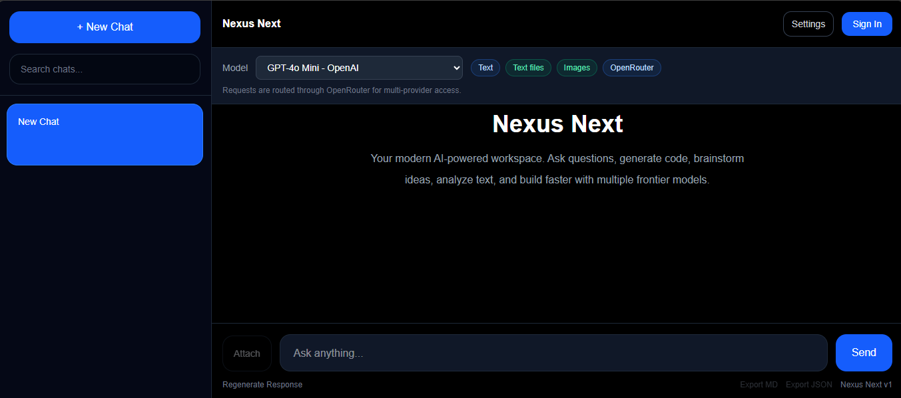
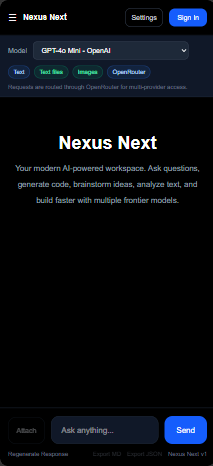

# Nexus Next

<p align="center">
  
</p>

<h1 align="center">Nexus Next</h1>

<p align="center">
  Modern Multi-Model AI Workspace built with Next.js, React, OpenRouter, Google AI Studio, Clerk, and Supabase.
</p>

<p align="center">
  <a href="https://nexusnext.vercel.app">Live Demo</a>
</p>

---

## Overview

Nexus Next is a modern multi-model AI chat workspace focused on providing a clean, extensible, and developer-friendly foundation for AI-powered applications.

The project currently supports real-time streaming conversations, multiple AI providers, authentication, file attachments, chat persistence, exports, search, and customizable model settings.

Its architecture is designed to scale toward advanced features such as Retrieval-Augmented Generation (RAG), AI agents, and workflow automation.

---

## Screenshots

### Desktop



### Mobile



---

## Feature Matrix

| Feature                      | Status |
| ---------------------------- | ------ |
| Multi-model chat             | ✅      |
| Streaming responses          | ✅      |
| OpenRouter integration       | ✅      |
| Google AI Studio integration | ✅      |
| Gemini models                | ✅      |
| Clerk authentication         | ✅      |
| Supabase persistence         | ✅      |
| Local chat storage           | ✅      |
| Chat search                  | ✅      |
| Chat export (Markdown)       | ✅      |
| Chat export (JSON)           | ✅      |
| File attachments             | ✅      |
| PDF support                  | ✅      |
| Markdown rendering           | ✅      |
| Settings panel               | ✅      |
| Stop generation              | ✅      |
| Response regeneration        | ✅      |

---

## Features

* Multi-model chat through OpenRouter and Google AI Studio
* Real-time streaming assistant responses
* Clerk authentication UI
* Supabase-backed chat persistence
* Local chat storage for signed-out users
* Chat creation, rename, delete, regenerate, and stop-generation controls
* Search across chat titles and messages
* Custom model settings

  * Model selection
  * Temperature
  * System prompt
* Markdown rendering with GitHub Flavored Markdown
* File attachment support

  * Images
  * PDFs
  * Plain text files
  * Markdown files
* Persisted attachment text extraction metadata
* Chat export to Markdown and JSON
* Componentized App Router architecture
* Reusable hooks and provider abstraction

---

## AI Providers

Currently supported:

* OpenRouter
* Google AI Studio

Tested models include:

* GPT-4o Mini
* Gemini 2.5 Flash
* Gemini 2.5 Pro
* Claude
* DeepSeek

The provider architecture is designed to support additional AI backends in the future.

---

## Tech Stack

* Next.js 16 App Router
* React 19
* TypeScript
* Tailwind CSS 4
* Clerk
* OpenRouter
* Google AI Studio
* Supabase
* React Markdown

---

## Platform Support

Nexus Next has been tested successfully on:

| Platform          | Status |
| ----------------- | ------ |
| Windows 11        | ✅      |
| Ubuntu Linux      | ✅      |
| Vercel Deployment | ✅      |

Tested with:

* Node.js 22 LTS
* pnpm 12.3.4 (pinned in `package.json`)

---

## Getting Started

### Install dependencies

```bash
pnpm install
```

### Create environment variables

```bash
cp .env.example .env.local
```

### Configure `.env.local`

```env
NEXT_PUBLIC_CLERK_PUBLISHABLE_KEY=
CLERK_SECRET_KEY=

OPENROUTER_API_KEY=
GEMINI_API_KEY=

NEXT_PUBLIC_SUPABASE_URL=
NEXT_PUBLIC_SUPABASE_ANON_KEY=
SUPABASE_SERVICE_ROLE_KEY=
```

### Start development server

```bash
pnpm dev
```

Open:

```text
http://localhost:3000
```

---

## Available Scripts

```bash
pnpm dev
pnpm build
pnpm start
pnpm lint
pnpm test
```

---

## Project Structure

```text
app/
  api/
  components/
    chat/
    layout/
    settings/
  hooks/
  types/

lib/
  ai/
  markdown/
  supabase/
  utils/

proxy.ts
```

### Important Modules

* `app/hooks/useChats.ts`

  * Chat state management and persistence

* `app/hooks/useStreamingChat.ts`

  * Streaming, abort, loading, and error handling

* `app/hooks/useChatSettings.ts`

  * Persistent model configuration

* `lib/ai/models.ts`

  * Model registry

* `lib/ai/openrouter.ts`

  * OpenRouter integration

* `lib/ai/providers/gemini.ts`

  * Google AI Studio integration

* `lib/markdown/renderer.tsx`

  * Markdown rendering

* `lib/utils/export-chat.ts`

  * Markdown and JSON exports

* `lib/supabase/server.ts`

  * Server-side Supabase client

---

## Environment Safety

Never commit:

```text
.env.local
```

or any real secret values.

The repository includes:

```text
.env.example
```

as a safe template for local development.

---

## Roadmap

### Near Term

* PDF export
* Theme controls
* OCR support for scanned PDFs
* Improved attachment processing

### Mid Term

* Supabase full-text search
* Shared conversations
* Usage analytics
* Better mobile experience

### Long Term

* Retrieval-Augmented Generation (RAG)
* Agent workflows
* Knowledge bases
* Public landing page

---

## Contributing

Contributions, suggestions, bug reports, and feature requests are welcome.

If you find an issue or have an idea for improvement, feel free to open an issue or submit a pull request.

---

## License

MIT License

---

Built with modern way using Next.js, React, OpenRouter, Google AI Studio, Clerk, and Supabase.

See [docs/roadmap.md](docs/roadmap.md) for the fuller plan.

